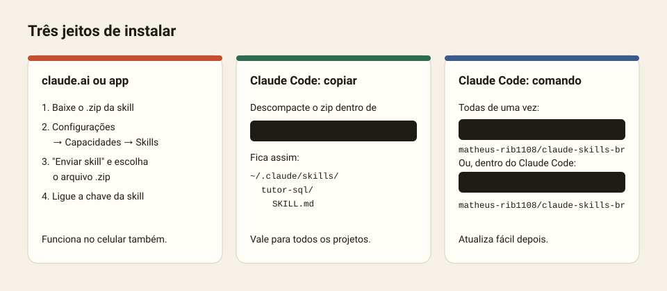

# Como instalar



## 1. No claude.ai ou no app do Claude

Funciona no navegador, no app de computador e no app de celular. É preciso estar num plano que tenha Skills, e a opção "Execução de código e criação de arquivos" precisa estar ligada em Configurações → Capacidades.

1. **Baixe o zip da skill.** Na [tabela do README](README.md#todas-as-skills), clique em "zip" na linha da skill. O arquivo tem a pasta da skill na raiz, que é o formato aceito pelo claude.ai.
2. Abra **Configurações → Capacidades**.
3. Na parte **Skills**, clique em **Enviar skill** e escolha o `.zip`.
4. A skill aparece na lista. Confira se a chave dela está ligada.
5. Teste com um pedido normal, por exemplo "faz um cronograma de estudos para mim".

**Quer todas?** Baixe [todas-as-skills.zip](https://github.com/matheus-rib1108/claude-skills-br/raw/main/dist/todas-as-skills.zip). O claude.ai recebe uma skill por envio, então use os zips individuais da pasta [`dist/`](dist/) ou da [Release](https://github.com/matheus-rib1108/claude-skills-br/releases/latest).

## 2. No Claude Code, copiando a pasta

1. Baixe e descompacte o zip.
2. Coloque a pasta da skill em:
   - Windows: `C:\Users\<você>\.claude\skills\`
   - Mac e Linux: `~/.claude/skills/`
3. O resultado tem que ser `.../.claude/skills/tutor-sql/SKILL.md`, sem uma pasta a mais no meio.
4. Abra uma conversa nova no Claude Code. As skills são lidas quando a conversa começa.

Para usar a skill só num projeto, coloque a pasta em `.claude/skills/` dentro do projeto em vez da pasta do usuário.

## 3. No Claude Code, com comando

Todas de uma vez, pelo terminal (precisa do Node.js):

```bash
npx skills add matheus-rib1108/claude-skills-br
```

Ou como plugin, dentro do Claude Code:

```
/plugin marketplace add matheus-rib1108/claude-skills-br
/plugin install skills-br@claude-skills-br
```

O jeito do plugin facilita atualizar depois: `/plugin marketplace update claude-skills-br`.

## Algumas skills precisam de programas

| Skill | Precisa de | Instalar |
|---|---|---|
| `video-link` | yt-dlp, faster-whisper, ffmpeg | `pip install yt-dlp faster-whisper` e `winget install Gyan.FFmpeg` |
| `photo-editor` | Pillow, OpenCV, rembg | `pip install pillow opencv-contrib-python-headless numpy rembg onnxruntime` |
| `video-maker` | Node.js 22+, ffmpeg | [nodejs.org](https://nodejs.org) e `winget install Gyan.FFmpeg` |
| `claude-chats`, `session-radar` | Python 3 | [python.org](https://www.python.org) |

As outras skills são só instruções e não precisam de nada.

## Não funcionou?

| Problema | Solução |
|---|---|
| O claude.ai recusa o zip | Envie o zip de **uma** skill, não o `todas-as-skills.zip`. |
| A skill não ativa | Abra uma conversa nova. Peça de um jeito parecido com os exemplos da página da skill. |
| No Claude Code ela não aparece | Confira se o caminho é `skills/<nome>/SKILL.md`, sem pasta a mais. |
| Erro de Python ou ffmpeg | Instale o programa da tabela acima e tente de novo. |

Ainda com problema? [Abra um relato](https://github.com/matheus-rib1108/claude-skills-br/issues/new?template=problema.yml).
