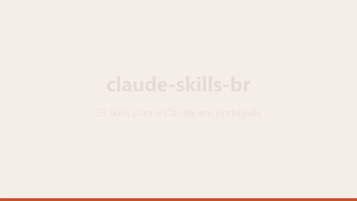
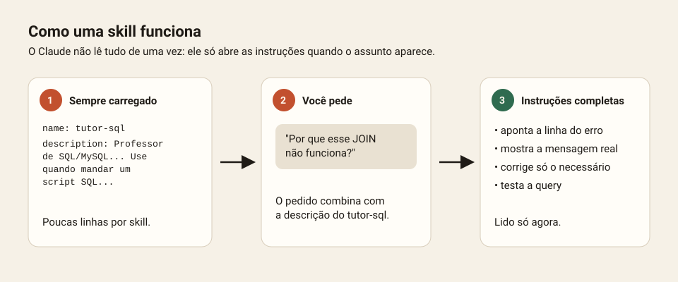
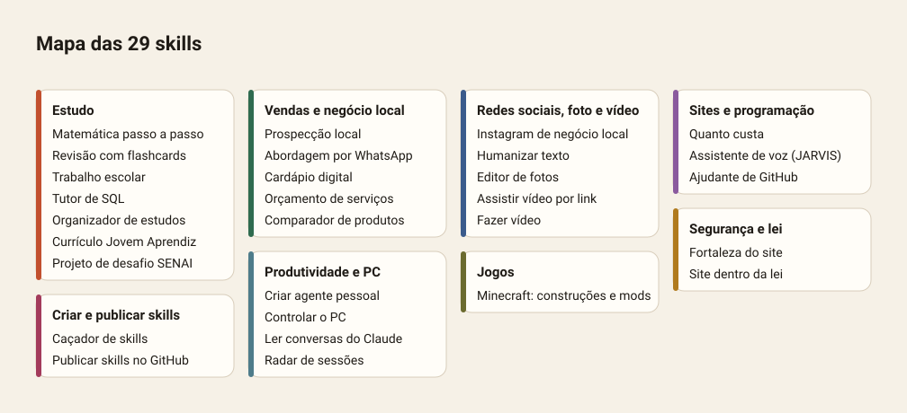

# claude-skills-br

**Skills para o Claude, em português do Brasil.** São 29 skills para estudo, vendas no comércio local, redes sociais, sites, segurança e produtividade. Você baixa todas ou só as que quiser, e cada uma tem uma página explicando o que faz.

<p align="center">
  
</p>

<p align="center">
  <a href="https://github.com/matheus-rib1108/claude-skills-br/raw/main/dist/todas-as-skills.zip"><b>⬇ Baixar todas as skills (.zip)</b></a> ·
  <a href="COMO-INSTALAR.md">Como instalar</a> ·
  <a href="CATALOGO.md">Skills de outras pessoas</a> ·
  <a href="DICAS.md">Dicas</a> ·
  <a href="#avalie-e-sugira">Avalie e sugira</a>
</p>

## O que é uma skill?

Uma skill é uma pasta com um arquivo `SKILL.md`. Esse arquivo ensina o Claude a fazer um tipo de tarefa do jeito certo, como corrigir SQL, montar um cardápio digital ou escrever a legenda de um post.

O Claude não lê todas as skills o tempo todo. Ele guarda só o nome e uma descrição curta de cada uma. Quando o seu pedido combina com uma descrição, ele abre as instruções completas e segue o passo a passo.



Você não precisa chamar a skill pelo nome. É só pedir normalmente.

## Todas as skills

Clique no nome para ver a explicação completa: o que faz, o que muda no Claude, exemplos de pedido, antes e depois, e dicas. O link "zip" baixa só aquela skill.



<!-- TABELA:INICIO -->
### Estudo

| Skill | Para que serve | Baixar |
|---|---|---|
| [Currículo Jovem Aprendiz](skills/curriculo-jovem-aprendiz/README.md) | Currículo de uma página para primeiro emprego, Jovem Aprendiz ou estágio, usando cursos e projetos como experiência, mais carta e treino de entrevista. | [zip](https://github.com/matheus-rib1108/claude-skills-br/raw/main/dist/curriculo-jovem-aprendiz.zip) |
| [Matemática passo a passo](skills/matematica-passo-a-passo/README.md) | Resolve exercícios de matemática do ensino médio e técnico explicando cada passo, com desenho da figura e conferência da conta. | [zip](https://github.com/matheus-rib1108/claude-skills-br/raw/main/dist/matematica-passo-a-passo.zip) |
| [Organizador de estudos](skills/organizador-de-estudos/README.md) | Monta um cronograma de estudos que cabe na sua semana real, com provas, Pomodoro, revisão espaçada e checagem semanal. | [zip](https://github.com/matheus-rib1108/claude-skills-br/raw/main/dist/organizador-de-estudos.zip) |
| [Projeto de desafio SENAI](skills/projeto-senai-desafio/README.md) | Estrutura projetos de desafio técnico (Grand Prix SENAI, desafios de empresa): problema, causa raiz, solução, Canvas, custos, KPIs e pitch. | [zip](https://github.com/matheus-rib1108/claude-skills-br/raw/main/dist/projeto-senai-desafio.zip) |
| [Revisão com flashcards](skills/revisao-flashcards/README.md) | Transforma a matéria em resumo de uma página, flashcards, quiz com gabarito comentado e plano de revisão até a prova. | [zip](https://github.com/matheus-rib1108/claude-skills-br/raw/main/dist/revisao-flashcards.zip) |
| [Trabalho escolar](skills/trabalho-escolar/README.md) | Ajuda em trabalhos de escola, SESI e SENAI: pesquisa, resumo, cartaz, slides, roteiro de fala cronometrado e perguntas do professor. | [zip](https://github.com/matheus-rib1108/claude-skills-br/raw/main/dist/trabalho-escolar.zip) |
| [Tutor de SQL](skills/tutor-sql/README.md) | Professor de SQL/MySQL em português: corrige scripts, explica comandos e cria missões no seu próprio banco de exemplo. | [zip](https://github.com/matheus-rib1108/claude-skills-br/raw/main/dist/tutor-sql.zip) |

### Vendas e negócio local

| Skill | Para que serve | Baixar |
|---|---|---|
| [Abordagem por WhatsApp](skills/abordagem-whatsapp-vendas/README.md) | Escreve a primeira mensagem de venda, o acompanhamento e as respostas para objeções, sem cara de spam. | [zip](https://github.com/matheus-rib1108/claude-skills-br/raw/main/dist/abordagem-whatsapp-vendas.zip) |
| [Cardápio digital](skills/cardapio-digital/README.md) | Cria cardápio digital leve com pedido pelo WhatsApp, horário aberto/fechado e QR code de mesa, para publicar de graça. | [zip](https://github.com/matheus-rib1108/claude-skills-br/raw/main/dist/cardapio-digital.zip) |
| [Comparador de produtos](skills/comparador-produtos-br/README.md) | Compara produtos de lojas brasileiras (Pichau, Kabum, Terabyte, Amazon, Mercado Livre) com tabela, ranking e link certo. | [zip](https://github.com/matheus-rib1108/claude-skills-br/raw/main/dist/comparador-produtos-br.zip) |
| [Orçamento de serviços](skills/orcamento-servicos/README.md) | Calcula quanto cobrar por site, cardápio, Instagram ou vídeo e monta proposta com 3 pacotes e contrato simples. | [zip](https://github.com/matheus-rib1108/claude-skills-br/raw/main/dist/orcamento-servicos.zip) |
| [Prospecção local](skills/prospeccao-local-br/README.md) | Acha negócios da sua cidade que precisam do seu serviço (site, cardápio, Instagram), dá nota de oportunidade e escreve a mensagem de abordagem. | [zip](https://github.com/matheus-rib1108/claude-skills-br/raw/main/dist/prospeccao-local-br.zip) |

### Redes sociais, foto e vídeo

| Skill | Para que serve | Baixar |
|---|---|---|
| [Humanizar texto](skills/humanizar-texto-pt/README.md) | Tira a "cara de IA" de textos em português, mantendo o sentido e a sua voz. | [zip](https://github.com/matheus-rib1108/claude-skills-br/raw/main/dist/humanizar-texto-pt.zip) |
| [Instagram de negócio local](skills/legenda-instagram-negocio/README.md) | Legendas, ideias de post, roteiro de Reels e calendário do mês para o Instagram de um negócio local, com a voz do dono. | [zip](https://github.com/matheus-rib1108/claude-skills-br/raw/main/dist/legenda-instagram-negocio.zip) |
| [Editor de fotos](skills/photo-editor/README.md) | Melhora fotos no seu computador: luz, cor, nitidez, ampliação com IA, remoção de fundo e recorte para Instagram ou site. | [zip](https://github.com/matheus-rib1108/claude-skills-br/raw/main/dist/photo-editor.zip) |
| [Assistir vídeo por link](skills/video-link/README.md) | Você manda o link (Instagram, TikTok, YouTube) e o Claude "assiste": baixa, transcreve a fala e tira quadros da imagem. | [zip](https://github.com/matheus-rib1108/claude-skills-br/raw/main/dist/video-link.zip) |
| [Fazer vídeo](skills/video-maker/README.md) | Faz vídeos .mp4 de verdade: Reels, TikTok, propaganda, explicativo com narração e legenda, slideshow de fotos. | [zip](https://github.com/matheus-rib1108/claude-skills-br/raw/main/dist/video-maker.zip) |

### Sites e programação

| Skill | Para que serve | Baixar |
|---|---|---|
| [Assistente de voz (JARVIS)](skills/assistente-voz-jarvis/README.md) | Guia para construir seu assistente pessoal de voz em Python: palavra de ativação, transcrição, resposta da IA, voz e comandos no PC. | [zip](https://github.com/matheus-rib1108/claude-skills-br/raw/main/dist/assistente-voz-jarvis.zip) |
| [Quanto custa](skills/cost-estimator/README.md) | Pesquisa o preço de hoje para colocar um site ou app no ar (hospedagem, banco, domínio, taxas de Pix e cartão) e recomenda o melhor custo-benefício. | [zip](https://github.com/matheus-rib1108/claude-skills-br/raw/main/dist/cost-estimator.zip) |
| [Ajudante de GitHub](skills/github-helper/README.md) | Faz tudo de Git e GitHub: cria repositório, primeiro commit, branches, PRs, releases, GitHub Pages e segurança grátis. | [zip](https://github.com/matheus-rib1108/claude-skills-br/raw/main/dist/github-helper.zip) |

### Segurança e lei

| Skill | Para que serve | Baixar |
|---|---|---|
| [Site dentro da lei](skills/legal-compliance/README.md) | Deixa o site pronto para publicar no Brasil: política de privacidade, termos de uso, banner de cookies com consentimento real e exclusão de dados (LGPD). | [zip](https://github.com/matheus-rib1108/claude-skills-br/raw/main/dist/legal-compliance.zip) |
| [Fortaleza do site](skills/site-fortress/README.md) | Auditoria de segurança completa do seu próprio site em 12 fases: segredos, dependências, login, pagamentos, cabeçalhos, LGPD. Corrige e prova cada correção. | [zip](https://github.com/matheus-rib1108/claude-skills-br/raw/main/dist/site-fortress.zip) |

### Produtividade e PC

| Skill | Para que serve | Baixar |
|---|---|---|
| [Criar agente pessoal](skills/agent-builder/README.md) | Cria seus próprios agentes de IA para tarefas que se repetem, como assistente de estudos, de redes sociais ou de sites. | [zip](https://github.com/matheus-rib1108/claude-skills-br/raw/main/dist/agent-builder.zip) |
| [Ler conversas do Claude](skills/claude-chats/README.md) | Lê suas conversas do claude.ai pela exportação oficial, acha a que você quer e faz no Claude Code o que foi pedido lá. | [zip](https://github.com/matheus-rib1108/claude-skills-br/raw/main/dist/claude-chats.zip) |
| [Controlar o PC](skills/pc-control/README.md) | Faz o Claude mexer no seu computador e no Chrome logado: abrir programas, usar sites, criar contas com o mínimo de esforço seu. | [zip](https://github.com/matheus-rib1108/claude-skills-br/raw/main/dist/pc-control.zip) |
| [Radar de sessões](skills/session-radar/README.md) | Mostra o que está acontecendo nas suas outras conversas do Claude Code (nuvem ou computador), resume e diz o que falta. | [zip](https://github.com/matheus-rib1108/claude-skills-br/raw/main/dist/session-radar.zip) |

### Jogos

| Skill | Para que serve | Baixar |
|---|---|---|
| [Minecraft: construções e mods](skills/minecraft-construcoes/README.md) | Ajuda com Minecraft Java modado: Litematica, schematics, conversão de Bedrock para Java, comandos seguros e conflitos entre mods. | [zip](https://github.com/matheus-rib1108/claude-skills-br/raw/main/dist/minecraft-construcoes.zip) |

### Criar e publicar skills

| Skill | Para que serve | Baixar |
|---|---|---|
| [Publicar skills no GitHub](skills/publicar-skills-github/README.md) | Monta e publica um repositório público de skills, como este: página de cada skill, downloads, instalação, notas e sugestões. | [zip](https://github.com/matheus-rib1108/claude-skills-br/raw/main/dist/publicar-skills-github.zip) |
| [Caçador de skills](skills/skill-hunter/README.md) | Procura skills, agentes e servidores MCP no GitHub, verifica a segurança e instala os bons. | [zip](https://github.com/matheus-rib1108/claude-skills-br/raw/main/dist/skill-hunter.zip) |
<!-- TABELA:FIM -->

## Como instalar


**No claude.ai ou no app (computador ou celular)**
1. Baixe o `.zip` da skill (link "zip" na tabela) ou [todas de uma vez](https://github.com/matheus-rib1108/claude-skills-br/raw/main/dist/todas-as-skills.zip). O zip com todas precisa ser descompactado primeiro: dentro dele há uma pasta por skill. Compacte e envie cada pasta separadamente.
2. Abra **Configurações → Capacidades → Skills**.
3. Clique em **Enviar skill** e escolha o arquivo.
4. Confira se a chave da skill ficou ligada.

**No Claude Code**
- Todas de uma vez, com um comando no terminal:
  ```bash
  npx skills add matheus-rib1108/claude-skills-br
  ```
- Ou, dentro do Claude Code, como plugin:
  ```
  /plugin marketplace add matheus-rib1108/claude-skills-br
  /plugin install skills-br@claude-skills-br
  ```
- Ou na mão: descompacte o zip em `~/.claude/skills/`, para ficar `~/.claude/skills/<nome-da-skill>/SKILL.md`. No Windows, essa pasta é `C:\Users\<você>\.claude\skills\`.

Passo a passo com mais detalhes e solução de problemas: [COMO-INSTALAR.md](COMO-INSTALAR.md).

## Avalie e sugira

- ⭐ **[Dar nota a uma skill](https://github.com/matheus-rib1108/claude-skills-br/issues/new?template=avaliar-skill.yml)**: de 1 a 5 estrelas, com comentário.
- 💡 **[Sugerir uma skill nova](https://github.com/matheus-rib1108/claude-skills-br/issues/new?template=sugerir-skill.yml)**: diga o que você queria que o Claude soubesse fazer.
- 🐞 **[Relatar um problema](https://github.com/matheus-rib1108/claude-skills-br/issues/new?template=problema.yml)**: a skill não ativou ou fez algo errado.
- 💬 **[Discussões](https://github.com/matheus-rib1108/claude-skills-br/discussions)**: perguntas, ideias e mostrar o que você fez com as skills.

## Mais

- [CATALOGO.md](CATALOGO.md): mais de 90 skills de outros autores, com link e licença, separadas por categoria.
- [DICAS.md](DICAS.md): como tirar mais das skills e como criar a sua.
- [docs/videos/demo.mp4](docs/videos/demo.mp4): o vídeo de demonstração em MP4.
- [CONTRIBUTING.md](CONTRIBUTING.md): como mandar uma skill sua para cá.

## Segurança

Skills são instruções, e algumas trazem scripts em Python. Antes de instalar uma skill (daqui ou de qualquer lugar), abra o `SKILL.md` e os scripts e veja o que fazem. Nenhuma skill daqui envia seus dados para fora, e as que mexem com contas ou compras pedem sua confirmação antes de agir.

## Licença

[MIT](LICENSE). As skills de outros autores citadas no [CATALOGO.md](CATALOGO.md) têm as próprias licenças e não estão copiadas aqui.
